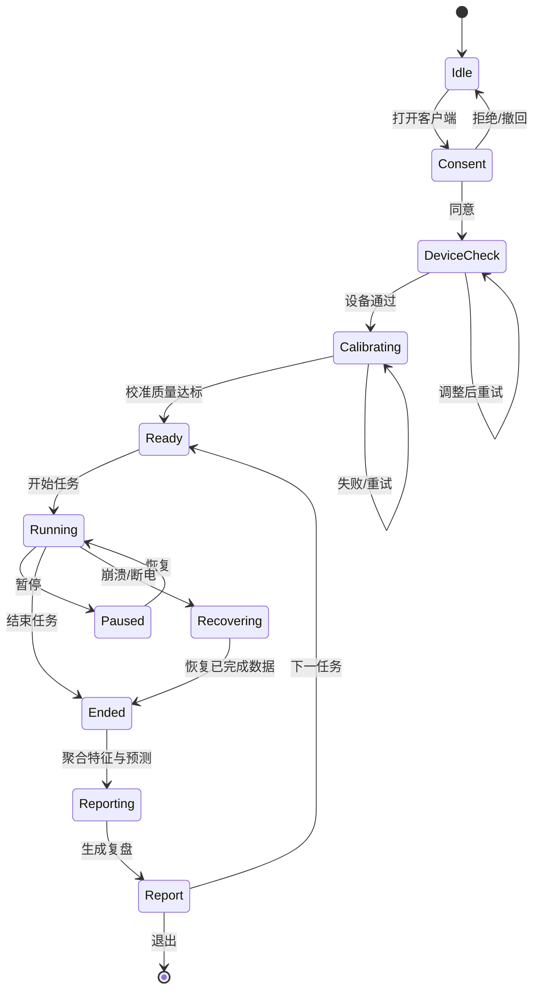

# EyeKnow 产品需求文档（PRD）

> 产品：EyeKnow——眼动感知的算法学习认知负荷评估平台  
> 版本：V1.0 教学试点版  
> 文档状态：评审稿  
> 更新日期：2026-10-25  
> 适用场景：AI + 教育 / 算法学习 / 认知负荷过程性评估

---

## 文档信息

| 项目 | 内容 |
|---|---|
| 产品名称 | EyeKnow |
| 一句话定位 | 用普通摄像头把算法学习中的“认知负荷与卡点”变成可解释、可行动的过程证据 |
| 本版目标 | 完成从“可演示原型”到“可在真实课堂试点”的产品化闭环 |
| 首发平台 | 洛谷（Chrome / Edge 浏览器插件） |
| 终端形态 | Windows 10/11 学生客户端 + 浏览器插件 + 教师 Web 控制台 |
| 目标用户 | 算法学习者、任课教师/教研人员、教育科研人员 |
| 文档负责人 | 产品负责人 |
| 共同评审 | 算法负责人、工程负责人、指导教师、试点教师 |
| 参考框架 | `PRDframework.md`（版本说明 / 背景目标 / 故事 / 概要设计 / 详细设计 / 交付设计） |
| 关联材料 | 《EyeKnow 项目计划书》《EyeKnow 商业计划书》《EyeKnow-眼动感知产品》 |
| 关联仓库 | `CoWora/cognitive-load-tracker`、`CoWora/ET_model` |

---

## 一、版本说明

### 1.1 迭代记录

| 版本 | 时间 | 阶段 | 主要变化 | 状态 |
|---|---|---|---|---|
| V0.1 | 2025 Q4 | 原型验证 | 完成普通摄像头视线采集、洛谷 AOI、任务级特征与离线分析的可行性验证 | 已归档 |
| V0.2 | 2026-02-27 | 链路验证 | 跑通“采集 → 特征 → 聚类/分类 → 实时预测面板”的端到端链路 | 已归档 |
| V1.0 | 2026-10-25 | 教学试点版 | 以真实课堂试点为目标，补齐产品边界、指标、隐私、教师工作流与验收标准 | 评审中 |

### 1.2 本版范围

**V1.0 必须完成：**

- 在 Windows 10/11 上完成可安装、可校准、可恢复的学生端。
- 在洛谷题目页完成稳定的 AOI 语义映射与页面连接状态提示。
- 将任务级预测刷新从“10 秒轮询”提升到“端到端 2–3 秒级”，并加入质量门控。
- 学生端提供低干扰 HUD、任务复盘、隐私与暂停入口。
- 教师端提供班级概览、实时监测、学生/任务详情、干预记录与班级报告。
- 所有对外展示的判断都能追溯到特征版本、模型版本、映射版本与数据质量。
- 完成 30 人左右、4 周规模的单课程试点，并留存可复核的数据与反馈。

**V1.0 明确不做：**

- 不做情绪识别、人格判断、疾病诊断或医疗用途。
- 不把负荷等级用于成绩、排名、奖惩或自动淘汰。
- 不承诺仅凭眼动即可判断“会不会做”或“是否理解”。
- 不做跨平台全量适配，不做移动端完整客户端。
- 不在默认情况下上传原始摄像头视频。

### 1.3 证据口径说明

本 PRD 将“材料中的表述”和“当前仓库可核验的结果”分开记录，避免把演示指标直接写成已验收指标。

| 等级 | 定义 | 在 PRD 中的使用方式 |
|---|---|---|
| E3 | 有留出集/跨被试评估、可复现实验报告与统计检验 | 可作为对外核心性能结论 |
| E2 | 真实课堂/竞赛场景使用，有用户反馈与运行记录，但无对照实验 | 可描述为“试点验证” |
| E1 | 内部演示、单机自测、样本量有限或缺少留出的结果 | 只能描述为“原型能力” |
| E0 | 仅有材料表述、尚未在仓库或实验报告中复现 | 必须标注“待复核” |

**当前最重要的口径结论：**

- 仓库当前可核验的任务级训练产物为 **30 个样本、185 个特征**，监督模型使用全量数据训练，尚无留出集指标。
- 对外材料中的 **50+ 样本、6 类聚类、5 折交叉验证 74%±8%** 属于历史申报口径；在重新产出可复现评估报告前，按 E0 处理。
- 当前监控脚本默认 **10 秒轮询**；模型单次推理可做到毫秒级，但“学生看到状态更新”的端到端体验不等于毫秒级。
- 当前洛谷插件主要按页面纵向比例切分 AOI；V1.0 需要升级为真实 DOM 语义锚点，并处理滚动、缩放和页面结构变更。
- 对外材料中的“首次”“空白”等绝对化表述，需经市场与法务复核后再使用。

## 二、背景与目标

### 2.1 行业与用户背景

算法与编程能力正在从“计算机专业课程”扩展为数字时代的基础能力。项目材料给出的市场背景包括：2022 年教育部新课标将编程纳入中小学信息科技必修课程；全国信息学奥林匹克竞赛参赛人数从 2019 年约 15 万人增长至 2025 年超过 80 万人；高校计算机类专业在校生规模超过 200 万人；洛谷、LeetCode 等刷题平台的国内注册用户累计超过 3000 万。上述数据用于说明需求规模，正式对外引用前需补充最新公开来源与统计口径。

但教学工具仍以“结果评价”为主：教师看到的是提交结果、通过率与分数，看不到学生在哪一段开始卡住、在哪个区域反复回看、何时出现持续高负荷。学生也往往无法区分“题目确实太难”和“当前状态不适合继续硬耗”。这一过程信息的缺失，就是本项目要解决的“认知黑箱”。

眼动信号的价值在于，它提供了不打断解题过程的注意力分配证据：注视时长反映信息加工强度，AOI 之间的转移反映搜索与整合策略，眨眼与注视稳定性可作为负荷与疲劳的辅助信号。普通 RGB 摄像头虽无法达到专业眼动仪的精度，但足以支撑“相对负荷变化”和“任务内卡点定位”这两类产品问题。

### 2.2 当前进度

| 能力 | 当前实现 / 证据 | 证据等级 |
|---|---|---|
| 学生端采集 | Python 客户端；L2CS-Net 视线估计、One Euro Filter、EAR 眨眼检测、I-VT 注视检测；9 点校准；输出 gaze、fixation、blink、AOI transition、task、event 与 session meta | E1 |
| 洛谷 AOI 插件 | Chrome/Edge 插件通过 HTTP 上报页面信息；当前按页面纵向比例划分标题、题目、输入输出、样例、提示等区域 | E1 |
| 特征与模型 | 仓库当前任务级特征矩阵为 185 维；KMeans 6 类；SVM 6 类分类器；已有相对负荷等级映射产物 | E1 |
| Web 平台 | 材料记载已基于 Flask 提供数据上传、批量处理、负荷分析与通义千问学习建议生成 | E1 |
| 真实场景 | 已在院级线上编程比赛部署；完成《面向对象程序设计》课堂观察与教师访谈，获得方向性反馈 | E2（无对照实验） |
| 实时链路 | 2026-02-27 完成采集、监控、预测面板的端到端试跑；当前监控默认 10 秒轮询 | E1 |
| 已报道指标 | 材料记载视线精度 3.3°、注视检测 F1 89%、用户体验 4.4/5；50+ 样本、5 折交叉验证 74%±8% | E1 / E0（待复现） |

**结论：** 产品已经具备“可演示的端到端原型”和真实场景试用基础，但尚未完成“可复核的模型证据、可规模化的教师工作流、可审计的数据合规”三项产品化工作。

### 2.3 现有产品的缺陷与产品化差距

| 维度 | 具体问题 | 对用户/业务的影响 | 优先级 |
|---|---|---|---|
| 模型证据 | 任务级样本仅 30 个；无留出集或跨被试评估；聚类标签为无监督伪标签 | 无法证明 74%±8% 的泛化能力；教师难以信任结论 | P0 |
| 实时性 | 当前为 10 秒轮询；预测结果缺少时序平滑与提示节流 | “高负荷”发现过晚；频繁提示会打断解题 | P0 |
| 判断可靠性 | 未定义低置信、遮挡、丢帧、校准失败时的降级策略 | 可能在无效数据上给出看似确定的结论 | P0 |
| AOI 语义 | 当前主要按页面纵向比例切分，滚动/缩放/响应式布局下容易漂移；代码编辑区支持不稳定 | “卡在哪个区域”不准确，教学解释力下降 | P0 |
| 校准体验 | 9 点校准为手动流程；缺少校准质量评级、失败原因与重试引导 | 首次使用失败率高；不同光照、眼镜、坐姿下精度波动 | P0 |
| 反馈设计 | 现有结果更像“分数/类别”，缺少证据链与下一步动作；LLM 建议可能脱离事实 | 学生知道“高负荷”但不知道做什么；教师难以干预 | P0 |
| 教师工作流 | 缺少班级、名单、任务发布、干预记录、班级报告的完整闭环 | 教师只能“看数据”，不能把数据变成教学动作 | P0 |
| 隐私合规 | 人脸视频、眼动与学习数据属于敏感信息；需覆盖知情同意、最小化、撤回、删除、审计 | 校园试点无法通过合规审查；用户信任风险 | P0 |
| 工程可运维 | 缺少统一会话协议、版本管理、崩溃恢复、遥测和模型监控 | 多用户试点时问题难以定位与回滚 | P1 |
| 业务价值 | 尚未验证“反馈是否改变学习行为”与“教师是否愿意持续使用” | 商业计划缺少可复用的效果证据 | P1 |

### 2.4 产品目标

**产品目标：** 让一次算法学习任务在 3 秒内获得“可解释的状态反馈”，并在任务结束后自动形成一条可复盘的证据链：何时、在哪个 AOI、出现了什么负荷变化、建议下一步做什么。

**试点目标：** 在一门算法课程中完成 30 人左右、4 周、至少 4 个任务的试点，验证：

- 学生能在不被打断的情况下理解并使用反馈；
- 教师能在 30 秒内定位需要关注的学生与共性卡点；
- 数据质量、模型置信度与隐私流程足以支撑课程级使用；
- 形成可复现的模型评估报告和可引用的效果证据。

**业务目标：** 以单课程试点形成可复制的 B 端交付模板，为后续院系/机构合作提供真实的部署、教师培训、数据合规与效果案例，而不是在 V1.0 阶段追求规模化收入。

**研究目标：** 建立“原始事件 → 特征 → 负荷标签/映射 → 反馈动作 → 学习结果”的可追溯数据链，为教育技术、认知科学与算法教学研究提供可复用的数据集与工具。

### 2.5 非目标

- 不把 EyeKnow 定位为“注意力监控”或“学习表现评分系统”。
- 不基于眼动推断情绪、性格、智力、诚信或疾病。
- 不替代教师判断，不自动决定学生是否需要补课、降级或淘汰。
- 不在 V1.0 承诺跨平台、跨题型、跨设备的普适精度。
- 不在默认设置下保存或上传原始视频；不把“同意”设计成默认勾选。
- 不为了演示效果牺牲数据质量门控；低置信时必须允许“暂不判断”。

### 2.6 完成后达到怎样的效果

| 角色 | 现在 | V1.0 完成后 |
|---|---|---|
| 学生 | 卡住后只能凭感觉判断“太难”还是“累了” | 看到相对负荷变化、主要卡点时间线与一个可执行的下一步 |
| 教师 | 只能看提交结果，课后靠经验复盘 | 看到班级负荷分布、需关注学生与共性 AOI 卡点，并能记录干预 |
| 教研/科研 | 数据分散、字段与模型版本不可追溯 | 可按同意范围导出带版本号的脱敏数据与报告 |
| 工程 | 单机演示为主，异常难定位 | 有统一会话协议、质量门控、日志、模型版本与回滚机制 |
| 项目 | 依赖申报材料中的历史指标 | 拥有可复现的试点证据与明确的能力边界 |

## 三、故事介绍

### 3.1 产品的意义

EyeKnow 不是给学生再增加一个“分数”，而是提供一面“认知过程的镜子”。它把原本只存在于主观感受里的“我卡住了”，转化为可以被回看、被讨论、被行动的证据。

产品承载三个转变：

1. **从结果到过程：** 从“做对/做错”转向“在哪一段、因为什么而卡住”。
2. **从主观到证据：** 从“我觉得有点累”转向“高负荷持续了 79 秒，主要集中在输入输出区”。
3. **从提醒到行动：** 从“你累了”转向“先休息 2 分钟，或用一个最小样例重推状态转移”。

这一定位也决定了产品的克制：只呈现与学习策略相关的相对状态，不做诊断，不制造焦虑，不把学生变成被持续监视的对象。

### 3.2 用户场景

#### 3.2.1 用户画像

| 用户 | 典型画像 | 核心任务 | 主要痛点 | 成功标准 |
|---|---|---|---|---|
| 学生（C 端） | 高校计算机专业本科生/竞赛生，18–24 岁，每周刷题 3–10 小时 | 在卡住时判断“继续想、休息、看提示还是看题解” | 无法区分难度与疲劳；复盘只记得“这题很难” | 一次任务内能理解状态并做出一次更优策略选择 |
| 教师（B 端） | 算法课程任课教师/竞赛教练，带 1–3 个班 | 在大班中快速找出需要干预的学生与共性卡点 | 过程不可见；课后复盘缺少证据 | 30 秒内定位 3–5 名需关注学生；课后能据此调整一节课 |
| 教研/科研 | 教育技术、认知科学方向研究生/教师 | 采集、标注、分析、复现实验 | 字段不统一、模型不可追溯、伦理流程复杂 | 能导出带同意与版本信息的脱敏数据 |
| 教务/IT | 院系教学管理员或实验室管理员 | 部署、账号、权限、数据安全 | 安装复杂、网络受限、隐私责任不清 | 一次部署可支持一个班级；问题可追踪、可回滚 |

#### 3.2.2 核心使用场景

**场景 S1：课前准备（学生 + 教师）**

- 教师创建班级、导入名单、发布第一次练习任务，并说明“这不是考试监控”。
- 学生安装客户端、阅读知情同意、完成摄像头与光照检查、完成 9 点校准。
- 系统给出“设备可用/建议调整”的明确结论，不把不可用状态伪装成可用。

**场景 S2：任务中（学生）**

- 学生打开洛谷题目，客户端自动识别页面与题目 ID，插件上报 AOI。
- 学生开始任务，系统在后台采集，不弹出频繁提示。
- 默认只显示一个很小的状态胶囊；当高负荷持续且置信度足够时，才展开一次可行动提示。
- 学生可以暂停、标记“这里卡住了”、休息或退出，所有操作都不影响成绩。

**场景 S3：任务后（学生）**

- 任务结束后 10 秒内生成复盘：负荷曲线、AOI 分布、主要卡点、数据质量、下一步建议。
- 学生可以查看证据，也可以选择“这不准确”并留下原因，作为模型改进数据。

**场景 S4：课堂中（教师）**

- 教师看到班级在线人数、需关注人数、数据有效率、平均任务时长。
- 风险列表按“高负荷持续时间 × 数据质量”排序，不展示逐帧视线。
- 教师可查看学生详情或直接记录一次干预，不把系统排序当作结论。

**场景 S5：课后复盘（教师 + 教研）**

- 班级报告聚合共性卡点：例如 14 人在“输入输出格式”区域反复回看。
- 教师据此调整下一节课的讲解顺序，并记录干预结果。
- 教研人员查看模型版本、特征版本、数据质量与匿名化后的统计结果。

**场景 S6：科研导出（科研用户）**

- 在授权范围内导出事件表、特征表、任务标签、模型输出与版本信息。
- 导出文件不含姓名、学号、原始视频；敏感字段以假名 ID 关联。

### 3.3 价值分析

#### 3.3.1 前后对比

| 维度 | 现状 | V1.0 目标 | 价值 |
|---|---|---|---|
| 过程可见性 | 只有提交结果 | 任务内负荷曲线 + AOI 卡点 | 把“认知黑箱”变成可讨论的证据 |
| 反馈时延 | 课后或凭感觉 | 2–3 秒级状态；任务后 10 秒内复盘 | 在还能改变策略时给出反馈 |
| 教师干预 | 依赖经验与课堂观察 | 班级风险分层 + 共性卡点 | 把有限注意力投向最需要的学生 |
| 数据复用 | 分散的 CSV 与实验脚本 | 版本化会话、特征、模型与报告 | 支撑科研与模型迭代 |
| 成本 | 专业眼动仪数万元 | 普通摄像头 + 本地软件 | 降低课堂规模化门槛 |

#### 3.3.2 价值假设与验证方式

| 假设 | 可测信号 | 验证方式 | V1.0 判定 |
|---|---|---|---|
| H1：低干扰状态提示能帮助学生更早停止无效硬耗 | 高负荷提示后的休息/看提示/标记卡点动作率；任务后自评“更清楚该做什么” | 试点问卷 + 行为事件 + 访谈 | 行动率 ≥40%；≥70% 学生认可“有帮助” |
| H2：教师看板能降低发现需关注学生的时间 | 完成“找出 3 名需关注学生”任务的时间与正确率 | 5 名教师可用性测试 | 中位时间 ≤30 秒；关键学生命中率 ≥80% |
| H3：任务复盘能提升复盘的具体性 | 复盘报告中被引用为“具体卡点”的比例 | 访谈编码 + 报告查看记录 | ≥60% 的受访学生能说出一个具体 AOI/时间段 |
| H4：数据回流能持续改善模型 | 新数据加入后留出集指标变化 | 版本化再训练 | 不以单次提升作为成功，要求评估流程可复现 |

#### 3.3.3 与运营/教学协作

- 教师培训：一次 20 分钟培训 + 一页“如何读报告”说明；明确“系统只提供线索，不替代教学判断”。
- 学生引导：首次使用 90 秒内完成同意、设备检查与校准；用“学习镜子”而非“监控”叙事。
- 试点运营：每周一次数据健康检查、一次教师访谈、一次模型/数据问题复盘。
- 对外传播：只引用已复现指标；区分“模型推理延迟”和“端到端刷新时间”；不承诺医学或成绩效果。

### 3.4 核心体验路径


> 图 3-1：从多模态信号采集，到认知负荷画像，再到学生/教师反馈与数据回流的设计思路图。


> 图 3-2：核心体验路径。学生负责学习动作，系统负责无感采集与解释，教师负责在班级层面干预。

#### 3.4.1 学生路径（主路径）

1. **启动与同意：** 打开客户端，阅读“采什么、为什么采、存多久、如何删除”，明确选择同意或退出。
2. **设备检查：** 摄像头可用性、分辨率、帧率、光照、人脸位置、眼镜反光检查；给出可执行的调整建议。
3. **校准：** 9 点校准；每个点显示进度与稳定性；失败时说明原因（光照/遮挡/头部移动）并允许重试，而不是直接进入任务。
4. **进入任务：** 打开洛谷题目页，插件识别题目 ID 与 AOI；客户端显示“已连接/未连接/页面不支持”。
5. **解题：** 后台采集；默认只显示状态胶囊；高负荷持续且置信度足够时，展开一次提示；提示提供“休息/标记卡点/继续”三个动作。
6. **结束：** 学生主动结束任务；系统检查数据完整性，低质量数据标记为“暂不判断”，不强行生成结论。
7. **复盘：** 负荷曲线、AOI 分布、主要卡点、下一步建议、数据质量与“反馈不准确”入口。
8. **沉淀：** 本地历史记录；在授权范围内同步到云端，供教师查看聚合报告。

#### 3.4.2 教师路径

1. 登录并校验角色。
2. 创建/进入班级，查看名单与设备准备状态。
3. 发布任务，说明数据用途与边界。
4. 在课堂中查看班级概览与风险列表。
5. 下钻到学生/任务报告，记录一次干预。
6. 课后查看班级共性卡点，调整教学。

#### 3.4.3 体验原则

- **不打断：** 默认不弹窗；提示必须可忽略、可暂停、可撤销。
- **不评判：** 使用“高负荷/需要调整策略”，不使用“注意力差/不认真”。
- **可解释：** 每个结论至少给出一条依据（时间段、AOI、数据质量）。
- **可退出：** 摄像头、采集、同步、历史记录均可单独关闭。
- **可纠错：** 学生和教师都能标记“判断不准确”，并进入模型改进闭环。

### 3.5 产品指标预测

#### 3.5.1 北极星指标

**每周有效复盘次数（Weekly Valid Reflection, WVR）**：一周内完成、数据质量合格、学生查看过任务复盘且至少产生一个后续动作（休息、标记卡点、查看提示、重新练习）的任务数。

选择理由：它同时约束“数据可用”“反馈被看到”“反馈带来行动”，比单纯的预测次数更接近产品价值。

#### 3.5.2 指标树

| 层级 | 指标 | V1.0 目标 | 说明 |
|---|---|---|---|
| 北极星 | 每周有效复盘次数 | 试点班 ≥60 次/周 | 30 人 × 每周 2 个有效任务的下限 |
| 获取 | 安装 → 同意率 | ≥95% | 同意文案清晰、可退出 |
| 激活 | 同意 → 2 次内校准通过率 | ≥85% | 允许 2 次内通过；失败有原因 |
| 使用 | 任务开始 → 有效预测率 | ≥80% | 质量门控通过且置信度达标 |
| 价值 | 有效预测 → 复盘查看率 | ≥70% | 任务结束后 24 小时内 |
| 留存 | 7 日内第二次有效任务率 | ≥40% | 试点期行为信号 |
| 教学 | 被标记需关注 → 教师记录干预率 | ≥60% | 只统计教师主动动作 |
| 质量 | 崩溃自由会话率 | ≥99% | 不含用户主动退出 |

#### 3.5.3 漏斗预测

| 漏斗阶段 | 定义 | 预测转化率 | 依据/假设 |
|---|---|---:|---|
| 安装 | 下载并完成首次启动 | 100% | 试点统一安装 |
| 知情同意 | 明确选择同意 | 95% | 自愿参与，可退出 |
| 设备通过 | 摄像头/光照/帧率达标 | 90% | 提供检查与调整建议 |
| 校准通过 | 2 次内达到质量门槛 | 85% | 9 点校准 + 质量评级 |
| 任务开始 | 识别题目并开始任务 | 95% | 插件与客户端联通 |
| 有效预测 | 质量门控通过且置信度达标 | 80% | 目标值，需试点验证 |
| 复盘查看 | 24 小时内打开任务复盘 | 75% | 任务后即时入口 |
| 二次使用 | 7 日内完成第二个有效任务 | 40% | 试点期行为假设 |

> 预测说明：以上为产品目标值，不是已经实现的承诺。按当前漏斗估算，100 次安装约产生 41 次“有效预测且查看复盘”的会话；试点将重点验证校准与有效预测两段损耗。

#### 3.5.4 模型与体验门槛

| 类别 | 指标 | V1.0 验收门槛 | 评估方式 |
|---|---|---:|---|
| 视线精度 | 校准后屏幕目标角误差中位数 | ≤3.5° | 9 点/16 点验证集；记录 P50/P90 |
| 视线稳定性 | P90 角误差 | ≤5.0° | 分光照、眼镜、坐姿分层 |
| 注视检测 | 与人工标注的 F1 | ≥0.85 | 至少 10 段、每段 ≥3 分钟 |
| 负荷分类 | 4 级宏观 F1 | ≥0.65 | 按受试者分组留出（GroupKFold/LOSO） |
| 高负荷识别 | 二分类召回 / 精确率 | 召回 ≥0.75；精确率 ≥0.70 | 以独立主观量表/行为标签为参照，阈值预注册 |
| 置信校准 | ECE | ≤0.15 | 可靠性图 + 分箱校准误差 |
| 实时性 | 端到端刷新 P95 | ≤3 秒 | 从新数据写入到 HUD 更新 |
| 稳定性 | 30 分钟会话崩溃率 | ≤1% | 自动化长稳测试 |
| 有效性 | 教师 30 秒内定位需关注学生 | ≥80% 命中 | 可用性测试 |

### 3.6 未来版本功能预测设计

| 版本 | 主题 | 关键能力 | 交付条件 |
|---|---|---|---|
| V1.0 | 教学试点版 | Windows 客户端、洛谷 AOI、秒级 HUD、任务复盘、教师班级看板、隐私中心 | 完成 30 人试点与模型复现报告 |
| V1.1 | 证据强化版 | 跨被试评估、置信校准、AOI v2、误判反馈闭环、研究导出 | 4 级模型达到验收门槛；数据字典冻结 |
| V1.2 | 课堂规模化版 | 多班级、任务发布、名单导入（CSV）、教师协作、班级趋势 | 2 个以上班级稳定运行；权限与日志通过 |
| V2.0 | 跨场景版 | LeetCode/VS Code 插件、更多题型、可选多模态信号、自适应提示 | 单场景模型可迁移；隐私与伦理评估通过 |

**未来版本的设计约束：**

- 任何新增信号（心率、姿态、键盘行为）都必须遵循最小化原则，并单独征得同意。
- 跨平台不是“换一个页面选择器”，而是需要新的 AOI 标注、数据采集与模型再校准。
- 自适应提示不得演化为自动解题或替代学习过程；应以“提示策略”而非“答案生成”为核心。

## 四、概要设计

### 4.1 模块设计


> 图 4-1：本地优先的四层架构。体验层负责触达，应用层编排任务，智能层完成眼动理解与预测，数据/基础层保证可追溯、可运维、可合规。


> 图 4-2：六个产品模块共享同一套会话 ID、任务 ID 与版本号，避免端上重复计算与语义漂移。

#### 4.1.1 分层职责

| 层 | 主要职责 | 关键设计 |
|---|---|---|
| 体验层 | 学生端、浏览器插件、教师端、研究视图 | 学生端单任务单目标；教师端从班级到个人不超过 3 次点击 |
| 应用层 | 会话编排、实时反馈、报告服务、数据服务 | 统一状态机；报告只读、可追溯；同步可关闭 |
| 智能层 | 视线、AOI、特征、模型、质量门控 | 本地推理优先；低置信降级；所有模型产物带版本 |
| 数据层 | 本地事件库、云端派生数据、身份与同意、模型注册表 | 原始视频不出设备；云端最小化；删除可审计 |
| 基础层 | 账号权限、隐私安全、可观测性、发布回滚 | 角色判断够了；日志脱敏；签名安装包；灰度发布 |

#### 4.1.2 模块说明

**S01 学生端（Windows 客户端）**

- 首次启动：产品说明、知情同意、摄像头权限、隐私模式。
- 设备准备：摄像头、分辨率、帧率、光照、人脸位置、眼镜反光检查。
- 校准：9 点校准、质量评级、失败原因、重试与重新校准。
- 任务工作区：任务开始/暂停/恢复/结束；低干扰 HUD；标记卡点；快捷键。
- 任务复盘：负荷曲线、AOI 分布、主要卡点、下一步建议、数据质量、准确性反馈。
- 历史与设置：历史任务、数据导出、暂停采集、删除本地数据、退出同步。

**S02 浏览器插件（Chrome / Edge）**

- 识别洛谷题目页与题目 ID；页面不支持时明确提示。
- 采集真实 DOM 语义锚点，生成题目描述、输入输出、样例、提示、代码编辑区等 AOI。
- 处理滚动、缩放、窗口位置与响应式布局变化；页面结构变更时上报告警。
- 与客户端通过本机回环地址通信；显示连接、心跳与 AOI 健康状态。
- 不读取页面输入内容、不记录键盘、不采集非必要页面信息。

**S03 分析引擎**

- Gaze Engine：L2CS-Net 视线估计、One Euro Filter 平滑、EAR 眨眼、I-VT 注视。
- AOI Engine：坐标映射、滚动/缩放校正、AOI 进入/离开/转移事件。
- Feature Engine：按 task 粒度生成 schema 化的特征向量；对缺失值、短任务、低帧率做显式处理。
- Model Service：KMeans 聚类 → 负荷映射 → SVM 分类；输出类别、概率、置信度与解释码。
- Quality Gate：校准、帧率、遮挡、有效注视比例、任务时长、类别覆盖检查。
- Temporal Smoother：对预测做滑动窗口/滞回处理，避免状态在相邻秒反复跳变。

**S04 教师端（Web 控制台）**

- 班级概览：在线、需关注、数据有效、平均任务时长。
- 实时监测：按风险排序，不展示逐帧视线；支持筛选“低置信/数据异常”。
- 学生详情：任务列表、负荷曲线、AOI 分布、干预记录。
- 任务报告：题目级共性卡点、班级分布、可导出报告。
- 隐私与权限：仅查看所带班级；原始视频不可见；导出脱敏。

**S05 数据平台**

- 本地事件库：会话、任务、原始事件、预测、报告；支持断电/崩溃恢复。
- 云端同步：只同步经同意的派生特征、报告与必要元数据；失败可重试。
- 身份与同意：假名 ID、班级关系、同意版本、撤回与删除任务。
- 模型注册表：特征 schema、模型文件、映射表、评估报告、灰度版本。
- 数据导出：学生个人导出、教师班级导出、科研脱敏导出。

**S06 安全与运维**

- 账号与权限：学生、教师、教研管理员、科研、平台管理员五个角色，用简单的 role 字段判断即可。
- 加密与脱敏：传输 TLS；敏感字段分级；日志不含原始视频与姓名。
- 操作日志：登录、查看、导出、删除、模型变更均留痕（够用，不搞复杂的审计系统）。
- 监控告警：崩溃、上传失败、模型异常、数据质量下降、页面结构变更。
- 发布与回滚：安装包签名、插件版本锁、模型版本回滚、灰度发布。

#### 4.1.3 角色与权限

| 角色 | 可见数据 | 可执行动作 | 明确禁止 |
|---|---|---|---|
| 学生 | 自己的任务、报告、原始事件 | 开始/暂停/结束、导出、删除、撤回同步 | 查看他人数据、修改模型 |
| 教师 | 所带班级的聚合与个体报告 | 查看风险、记录干预、导出班级报告 | 查看原始视频、跨班访问、导出可识别数据 |
| 教研管理员 | 授权班级/课程的聚合数据 | 配置课程、查看趋势、生成教研报告 | 越过同意范围使用数据 |
| 科研用户 | 经同意的脱敏数据集 | 导出、分析、申请再训练 | 反推身份、商业化转售 |
| 平台管理员 | 系统配置与操作日志 | 账号、版本、告警、回滚 | 无审批查看原始内容 |
| 算法服务 | 授权数据的派生特征 | 训练、评估、生成模型卡 | 直接访问姓名/学号/原始视频 |

#### 4.1.4 外部集成与边界

| 集成 | 协议/方式 | 数据 | 安全要求 |
|---|---|---|---|
| 插件 ↔ 客户端 | 本机 HTTP/WebSocket | 页面 URL、题目 ID、AOI 矩形、滚动/缩放 | 仅绑定 127.0.0.1；一次性 token；拒绝公网访问 |
| 客户端 ↔ 云端 | HTTPS | 派生特征、报告、任务元数据 | 学生同意；可暂停；失败重试 |
| 教师端 ↔ 云端 | HTTPS + 登录态 | 班级、报告、干预记录 | 角色判断；会话过期；操作留痕 |
| 平台 ↔ LLM | 服务端 HTTPS | 结构化特征、报告摘要，不含视频/姓名 | 服务端代理；敏感字段过滤；输出模板约束 |
| 平台 ↔ 学校账号 | OAuth/OIDC（后续） | 身份与班级关系 | 最小字段；不存储密码 |

### 4.2 功能清单

#### 4.2.1 优先级定义

- **P0：** 没有它就无法开展合规、可信的课堂试点。
- **P1：** 显著影响试点效果或规模化效率，可在 V1.0 后期/V1.1 交付。
- **P2：** 面向未来场景，不纳入 V1.0 验收。

#### 4.2.2 P0 功能

| ID | 模块 | 功能 | 验收摘要 |
|---|---|---|---|
| F-01 | S01 | 知情同意与隐私说明 | 首次启动必须明确选择；可查看版本、用途、保留期、删除方式；拒绝不影响其他功能 |
| F-02 | S01 | 设备与环境检查 | 摄像头/帧率/光照/人脸位置检查；失败给出可执行建议；记录检查结果 |
| F-03 | S01 | 9 点校准与质量评级 | 2 次内通过率 ≥85%；失败说明原因；质量分进入后续门控 |
| F-04 | S02 | 洛谷页面识别与 AOI v2 | 识别题目 ID；DOM 语义区域 + 滚动/缩放校正；页面变更告警 |
| F-05 | S01/S02 | 会话与任务生命周期 | 开始、暂停、恢复、结束、异常恢复；时间戳一致；状态可追溯 |
| F-06 | S01 | 数据采集与本地恢复 | 6 类事件表 + meta；断电/崩溃后可恢复已完成部分；不丢整段 |
| F-07 | S03 | 特征 schema v1.0 | 字段命名、类型、缺失值规则冻结；特征向量可复现；版本随会话保存 |
| F-08 | S03 | 任务级预测与置信度 | 输出 L1–L4、cluster、概率、confidence、quality；只在有效特征上预测 |
| F-09 | S03 | 质量门控与“暂不判断” | 低置信/低质量不显示确定结论；给出原因与重试建议 |
| F-10 | S01 | 学生 HUD | 默认折叠；可拖动/热键隐藏；高负荷提示有节流；不遮挡主编辑区 |
| F-11 | S01 | 任务复盘 | 10 秒内生成；含曲线、AOI、卡点、建议、质量、模型版本 |
| F-12 | S01 | 历史与隐私中心 | 查看/导出/删除个人数据；关闭同步；撤回同意 |
| F-13 | S05 | 云端同步（可选） | 学生授权后才上传；只传派生数据；失败可重试；状态可见 |
| F-14 | S04 | 教师班级概览 | 在线、需关注、数据有效、平均时长；30 秒内理解 |
| F-15 | S04 | 教师监测与学生详情 | 按风险排序；可下钻；不展示逐帧视频；低置信单独标记 |
| F-16 | S04 | 干预记录与班级报告 | 记录动作/备注；班级报告含共性卡点；可导出脱敏 PDF/CSV |
| F-17 | S05 | 特征/模型/映射版本管理 | 每次预测可追溯三版本；模型可灰度/回滚 |
| F-18 | S06 | 监控、日志与崩溃恢复 | 崩溃自由会话 ≥99%；关键错误有告警；日志脱敏 |

#### 4.2.3 P1 功能

| ID | 模块 | 功能 | 价值 |
|---|---|---|---|
| F-19 | S04/S05 | 班级、名单、邀请与任务发布 | 降低教师组织成本 |
| F-20 | S04/S05 | 基于事实的建议生成 | 用模板 + 结构化特征约束 LLM，减少幻觉 |
| F-21 | S05 | 科研脱敏导出 | 支持教育研究与模型迭代 |
| F-22 | S01/S04 | 误判反馈与再训练闭环 | 收集“哪里不准确”，形成高质量纠错集 |
| F-23 | S04 | 多班级与趋势对比 | 支持教研与规模化 |
| F-24 | S02/S03 | LeetCode Beta | 验证跨平台可迁移性 |
| F-25 | S01 | 可访问性设置 | 字号、对比度、色盲友好、键盘操作 |
| F-26 | S03 | 个体基线校准 | 用个人历史降低跨人差异 |

#### 4.2.4 P2 功能

| ID | 模块 | 功能 | 说明 |
|---|---|---|---|
| F-27 | S02/S03 | VS Code / IDE 插件 | 支持本地编码场景；需新的 AOI 与数据协议 |
| F-28 | S01/S03 | 多模态信号 | 心率、姿态、键盘节奏等；单独同意与伦理评估 |
| F-29 | S04/S05 | 名单批量导入（CSV） | 省去手动录入，够用就行 |
| F-30 | S01 | 移动端伴侣 | 仅查看报告与提醒，不承担采集 |
| F-31 | S03/S04 | 自适应提示策略 | 基于状态与历史选择提示，不直接给答案 |

## 五、详细设计

### 5.1 功能图 demo

#### 5.1.1 全局展示规则

**负荷等级与文案**

| 等级 | 内部定义 | 学生端文案 | 教师端文案 | 视觉 |
|---|---|---|---|---|
| L1 | 相对最低负荷 | 状态平稳 | 低负荷 | 绿色，最低强调 |
| L2 | 相对较低负荷 | 正常投入 | 较低负荷 | 青绿色 |
| L3 | 相对中高负荷 | 可能需要调整策略 | 中高负荷 | 琥珀色 |
| L4 | 相对最高负荷 | 建议休息或换策略 | 高负荷 | 橙红色，避免闪烁 |

**展示原则**

1. 学生端不展示 6 个原始 cluster，只展示 L1–L4 与“暂不判断”；cluster 仅用于内部追溯。
2. 任何等级都必须同时展示置信度或数据质量；不得只给一个斩钉截铁的标签。
3. 颜色 + 文字 + 图标三重编码，保证色盲用户可理解。
4. 不使用“危险”“异常”“注意力差”等诊断性或评价性词汇。
5. 低置信时不触发主动提示；仅在展开面板中说明“数据不足，暂不判断”。
6. 报告中的每一条判断题都应能下钻到时间段、AOI 与数据质量。

#### 5.1.2 页面 A：任务工作区


> 图 5-1：任务工作区低保真稿。左侧为带语义 AOI 的题目页，右侧为代码区；HUD 默认折叠，展开后只提供“休息/标记卡点”等可行动作。

**默认状态**

- HUD 折叠为 96×32 的小胶囊，显示“L2 · 82%”与一个状态点；位于屏幕右下角，可拖动。
- 快捷键 `Ctrl+Shift+H` 隐藏/显示；隐藏后仍可在托盘恢复。
- 默认不遮挡代码编辑区；若用户把 HUD 拖到编辑区，首次提醒“可能遮挡代码”，但不强制移动。
- “仅记录”模式：不显示等级，只在任务结束后生成报告。

**展开 HUD 的触发**

- 用户点击/悬停胶囊；
- 高负荷持续满足提示条件；
- 用户主动打开“当前状态”面板。

**主动提示规则**

| 条件 | 阈值 | 行为 |
|---|---|---|
| 任务已持续 | ≥90 秒 | 才允许首次提示；任务 <90 秒直接跳过主动提示（短任务靠任务后复盘） |
| 负荷等级 | L3 或 L4 | 才允许提示 |
| 置信度 | ≥0.70 | 低于阈值不提示 |
| 数据质量分 | ≥0.70 | 低质量不提示 |
| 负荷**连续**持续时间 | L3 ≥60 秒；L4 ≥30 秒 | **起点为进入 L3/L4 的时刻**，不是任务开始；负荷中间回落则计时器清零 |
| 频率 | 同一任务最多 1 次/5 分钟 | 防止打断 |
| 用户忽略/关闭 | 同一任务 10 分钟内不再提示 | 尊重用户选择 |
| 用户标记“不准确” | 本任务不再提示 | 进入误判反馈 |

**提示内容**

- 主文案：`当前负荷偏高，已持续 02:14。`
- 解释：`主要在「输入输出格式」与「样例」之间反复回看。`
- 动作：`休息 2 分钟` / `标记卡点` / `继续`。
- 免责声明：`这是基于眼动的相对状态估计，不是诊断，也不影响成绩。`

**按钮与快捷键**

| 控件 | 行为 | 备注 |
|---|---|---|
| 开始任务 | 建立 task_id，开始计时与采集 | 需要页面已连接 |
| 暂停/恢复 | 暂停采集与预测；恢复后不补算暂停段 | 暂停事件写入 events |
| 结束任务 | 校验数据完整性，生成报告 | 可标记 AC/WA/TLE/放弃 |
| 标记卡点 | 写入学生主观卡点时间戳 | 与模型卡点对比 |
| 休息 2 分钟 | 启动休息计时，暂停提示 | 不暂停采集，除非用户选择 |
| 仅记录 | 关闭实时等级显示 | 仍生成报告 |
| 退出 | 保存已完成数据并退出 | 二次确认 |

#### 5.1.3 页面 B：任务复盘


> 图 5-2：任务复盘低保真稿。先给结论与证据，再给下一步动作；所有判断都标注质量与版本。

**信息顺序**

1. 任务信息与数据有效性；
2. 负荷曲线与峰值/高负荷累计；
3. AOI 注意力分配；
4. 主要卡点（时间段 + AOI）；
5. 下一步建议（最多 2 条）；
6. 数据质量、模型版本与免责声明；
7. “判断不准确”反馈入口。

**文案要求**

- 使用“可能”“倾向于”“建议”等表达，避免确定性诊断。
- 建议必须可执行，例如“用一个最小样例手推状态转移”，而不是“提高专注力”。
- 当数据不足时，报告只展示数据质量与原因，不展示负荷结论。
- LLM 生成建议必须引用结构化证据；没有证据的内容不得生成。

#### 5.1.4 页面 C：教师班级看板


> 图 5-3：教师端班级看板低保真稿。默认聚合到班级与共性卡点，个体列表按风险与数据质量排序。

**设计原则**

- 首屏只回答四个问题：多少人、多少需关注、数据是否有效、共性卡点在哪里。
- 风险排序 = 高负荷持续时间 × 数据质量 × 置信度；不使用单一“危险指数”。
- 默认展示假名或学号后四位；教师可切换真实姓名，但操作留痕。
- 不展示逐帧视线、原始视频或完整人脸。
- 每个班级报告都能下钻到题目与 AOI，便于教师调整教学。

**教师动作**

| 动作 | 说明 | 记录 |
|---|---|---|
| 查看学生详情 | 查看该生的任务列表与报告 | 访问日志 |
| 记录干预 | 选择“课后单独沟通/调整练习/课堂讲解/继续观察” + 备注 | 干预记录 |
| 导出班级报告 | 导出脱敏 PDF/CSV | 导出日志 |
| 标记误判 | 对某条判断反馈不准确 | 进入改进队列 |
| 隐藏低质量数据 | 过滤掉低置信/短任务 | 只影响视图，不删除数据 |

#### 5.1.5 会话状态机



**状态规则：**

- `Running` 才产生任务级特征；`Paused` 段不参与负荷计算，但保留时间戳。
- `Recovering` 只恢复已落盘数据，不伪造缺失段。
- `Reporting` 失败可重试；重试仍失败则生成“数据不足”报告，不阻塞下一任务。
- 任何状态下用户都可以撤回同意；撤回后停止采集并进入删除流程。

#### 5.1.6 异常与降级设计

| 场景 | 检测方式 | 用户提示 | 系统行为 |
|---|---|---|---|
| 摄像头不可用 | 打开失败/无帧 | “未检测到摄像头，请检查权限或连接” | 不进入校准；允许退出 |
| 人脸丢失 | 连续 N 帧无检测 | “请回到画面中央” | 标记丢帧；超过阈值暂停预测 |
| 帧率过低 | 10 秒窗口 FPS < 5 | “当前设备性能不足，实时提示将受限” | 降级为任务后复盘 |
| 校准失败 | 误差/稳定性不达标 | 显示具体原因与重试按钮 | 不允许带病进入任务；可退出 |
| 插件未连接 | 心跳超时 | “未连接到页面，AOI 将不可用” | 只做粗粒度采集，不声称细粒度卡点 |
| AOI 结构变化 | 选择器/锚点失配 | “页面结构变化，AOI 受限” | 使用兜底区域；上报 schema mismatch |
| 低置信 | confidence < 0.55 | “暂不判断” | 不触发提示；报告标注原因 |
| 数据质量低 | 有效注视 < 70% 或任务 < 90 秒 | “数据不足，建议重新采集” | 不生成确定结论 |
| 同步失败 | 网络/服务错误 | “已保存在本地，稍后重试” | 队列重试；不阻塞任务 |
| 模型文件缺失/损坏 | 校验失败 | “分析服务暂不可用” | 保留原始数据；提示联系管理员 |

#### 5.1.7 模型输出与解释

**输入：** 任务级特征向量、任务元数据、AOI 覆盖信息、数据质量分。  
**输出：**

```json
{
  "valid": true,
  "task_id": "task_001",
  "load_level": "L3",
  "cluster_id": 1,
  "confidence": 0.82,
  "probabilities": {"L1": 0.05, "L2": 0.13, "L3": 0.64, "L4": 0.18},
  "quality_score": 0.91,
  "reason_codes": ["AOI_SWITCH_FREQUENCY_HIGH", "FIXATION_ENTROPY_HIGH"],
  "model_version": "svm-2026.10.0",
  "feature_schema": "feature-v1.0.0",
  "mapping_version": "map-v1.0.0",
  "latency_ms": 180
}
```

**解释码规则：**

- 解释码只描述可观察现象，不宣称因果：如“AOI 转移频率高”“题目区注视占比高”“代码区长时间无新增编辑”。
- 每个解释码必须绑定阈值、时间窗与特征版本。
- 若解释码依赖的 AOI 不可用，则不得展示该解释。
- 学生端最多展示 2 条解释；教师端可展开全部，但按证据强度排序。

#### 5.1.8 数据 schema（V1.0 冻结）

| 文件 | 关键字段 | 说明 |
|---|---|---|
| `session_meta.json` | session_id, pseudonymous_id, consent_version, app_version, os, gpu, feature_schema, model_version, mapping_version, start/end, quality | 会话级元数据 |
| `gaze_data.csv` | timestamp, gaze_x/y, screen_x/y, yaw, pitch, aoi_id, aoi_name, is_luogu, is_fixation, fixation_id, task_id, quality_flags | 原始视线与 AOI |
| `fixations.csv` | fixation_id, start/end, duration, center_x/y, aoi_id, task_id | 注视事件 |
| `blinks.csv` | timestamp, blink_id, ear, task_id | 眨眼事件 |
| `aoi_transitions.csv` | timestamp, from_aoi, to_aoi, task_id | AOI 转移 |
| `tasks.csv` | task_id, problem_id, difficulty, start/end, duration, result, subjective_difficulty, subjective_effort | 任务信息 |
| `events.csv` | timestamp, type, task_id, description | 生命周期与用户动作 |
| `predictions.jsonl` | timestamp, task_id, cluster_id, load_level, confidence, probabilities, quality_score, reason_codes, versions, latency_ms | 每次预测 |
| `feedback_events.csv` | timestamp, task_id, type, target, detail | 提示动作、报告查看、误判反馈 |

**版本与兼容：**

- 特征 schema、模型、映射表必须分别版本化，且随会话保存。
- 新旧 schema 不兼容时，不得静默拼接训练。
- 导出时附带数据字典与版本清单。

### 5.2 页面关系图 mock up


> 图 5-4：学生端、云端与教师端的页面关系。实线为主流程，虚线为只读/反馈关系。

#### 5.2.1 页面清单

| 页面 ID | 页面 | 核心内容 | 主要按钮 |
|---|---|---|---|
| P01 | 启动/知情同意 | 产品说明、数据用途、保留期、退出方式 | 同意并继续、拒绝、查看完整说明 |
| P02 | 设备检查 | 摄像头、帧率、光照、人脸位置、眼镜反光 | 重新检查、调整说明、继续 |
| P03 | 9 点校准 | 校准点、进度、稳定性、质量评级 | 重试、跳过（不建议）、退出 |
| P04 | 会话首页 | 最近任务、设备状态、插件状态、隐私入口 | 开始任务、历史、设置 |
| P05 | 任务工作区 | 题目页连接、AOI、HUD、暂停/结束 | 暂停、标记卡点、结束、仅记录 |
| P06 | 任务小结 | 数据质量、预测、失败原因 | 查看复盘、重新采集、结束 |
| P07 | 历史复盘 | 任务列表、趋势、报告 | 查看、导出、删除 |
| P08 | 设置/隐私 | 采集开关、同步、删除、同意版本 | 保存、撤回、删除全部 |
| T01 | 教师登录 | 账号、角色、班级 | 登录、名单导入（CSV，后续） |
| T02 | 班级概览 | KPI、风险列表、共性卡点 | 查看监测、导出 |
| T03 | 实时监测 | 在线状态、风险排序、过滤 | 下钻、标记异常 |
| T04 | 学生详情 | 任务列表、曲线、AOI、干预记录 | 记录干预、导出 |
| T05 | 任务报告 | 题目级分布、班级卡点 | 导出、标记误判 |
| T06 | 干预记录 | 动作、备注、跟进状态 | 保存、关闭 |
| T07 | 班级报告/导出 | 周报、题目热力图、脱敏设置 | 导出 PDF/CSV |
| C01 | 身份/班级/同意 | 假名 ID、同意版本、班级关系 | 内部服务 |
| C02 | 会话与任务记录 | 会话索引、任务索引 | 内部服务 |
| C03 | 派生特征与报告 | 特征、预测、报告、版本 | 内部服务 |
| C04 | 模型/特征版本 | 模型卡、评估报告、灰度状态 | 内部服务 |
| C05 | 审计/删除 | 访问、导出、删除任务 | 内部服务 |

#### 5.2.2 导航与跳转规则

- 学生端主流程只允许线性前进：P01 → P02 → P03 → P04 → P05 → P06 → P07；用户可随时退出。
- P05 是单任务工作区，不允许同时开启多个任务；切换任务必须先结束当前任务。
- 教师端从 T02 到 T03/T04 最多 2 次点击；从 T02 到 T05 最多 3 次。
- 所有报告页提供“数据质量/版本”入口，不允许只给结论。
- 低置信、低质量、AOI 受限时，页面必须显式标注，不得用灰色小字隐藏。
- 撤回同意后，学生端清空可见会话并停止同步；云端进入删除队列。

## 六、交付设计

### 6.1 数据分析设计

#### 6.1.1 数据分层与原则

| 数据层 | 内容 | 默认位置 | 保留策略 | 访问者 |
|---|---|---|---|---|
| L0 原始视频 | 摄像头帧 | 设备内存，默认不落盘 | 不保留 | 仅本地处理进程 |
| L1 原始事件 | gaze、fixation、blink、AOI、task、event | 本地 | 默认 90 天；可手动删除 | 学生本人 |
| L2 派生数据 | 特征、预测、质量分、理由码 | 本地 + 云端（可选） | 试点期 + 6 个月；可撤回 | 学生、授权教师 |
| L3 聚合数据 | 班级统计、题目热力图 | 云端 | 试点期 + 1 年 | 教师、教研管理员 |
| L4 研究数据 | 脱敏事件/特征/标签 | 受控存储 | 按研究协议 | 科研用户（审批后） |
| L5 操作日志 | 登录、查看、导出、删除、模型变更 | 云端 | 90 天 | 平台管理员 |

**原则：**

- 原始视频默认不出设备、不落盘；如未来需要保存，必须单独同意并说明用途。
- 产品分析数据与研究数据分开；研究导出必须再次校验同意范围。
- 所有数据集带 `consent_version`、`feature_schema`、`model_version`、`mapping_version`。
- 删除采用“可验证删除”：本地删除 + 云端删除任务 + 备份过期清理。

#### 6.1.2 埋点事件字典

| 事件名 | 触发时机 | 关键属性 | 用途 | 去向 |
|---|---|---|---|---|
| `app_open` | 客户端启动 | app_version, os, device_class | 安装/启动漏斗 | 产品 |
| `consent_view` | 展示同意页 | consent_version | 告知完成率 | 产品 |
| `consent_grant` | 用户同意 | consent_version, scope | 合规与漏斗 | 产品 + 审计 |
| `consent_revoke` | 撤回同意 | consent_version, at | 删除流程 | 审计 |
| `device_check` | 设备检查完成 | camera_ok, fps, lighting, face_ok, error_code | 校准前损耗 | 产品 |
| `calibration_start` | 开始校准 | attempt | 体验损耗 | 产品 |
| `calibration_result` | 校准结束 | success, error_deg, stability, attempt, reason | 质量与失败原因 | 产品 + 研究 |
| `page_connected` | 插件识别题目页 | site, problem_id, aoi_count, schema_version | AOI 健康度 | 产品 |
| `aoi_schema_mismatch` | DOM 锚点失配 | site, missing_aoi, page_version | 页面变更告警 | 产品 + 工程 |
| `task_start` | 开始任务 | task_id, problem_id, difficulty | 使用漏斗 | 产品 + 研究 |
| `task_pause` | 暂停 | reason | 体验 | 产品 |
| `task_end` | 结束任务 | result, duration, data_quality | 有效会话 | 产品 + 研究 |
| `prediction_emitted` | 输出预测 | load_level, confidence, quality_score, latency_ms, versions | 模型健康 | 产品 + 研究 |
| `quality_gate_blocked` | 质量门控拦截 | reason_codes, quality_score | 数据质量 | 产品 |
| `prompt_shown` | 展示主动提示 | load_level, confidence, reason_codes | 干预机会 | 产品 |
| `prompt_action` | 用户响应提示 | action(rest/continue/mark), latency | 价值验证 | 产品 |
| `report_generated` | 报告生成 | task_id, quality_score, latency_ms | 报告稳定性 | 产品 |
| `report_viewed` | 打开复盘 | source, delay | 价值链路 | 产品 |
| `accuracy_feedback` | 标记误判 | target, reason, free_text_optional | 模型改进 | 研究 |
| `sync_result` | 同步结束 | success, retry_count, bytes_class | 稳定性 | 产品 |
| `teacher_dashboard_open` | 教师打开看板 | class_id, role | 教师使用 | 产品 |
| `teacher_intervention` | 记录干预 | type, student_pseudonym, task_id | 教学闭环 | 产品 + 研究 |
| `export_requested` | 申请导出 | scope, format, deidentified | 合规审计 | 审计 |
| `data_delete_requested` | 申请删除 | scope | 合规 | 审计 |

> 埋点中不得包含原始视频、完整人脸、姓名、学号、代码内容或题目答案。自由文本反馈需提示用户不要填写敏感信息。

#### 6.1.3 指标定义

| 指标 | 公式 | 数据源 | 备注 |
|---|---|---|---|
| 校准通过率 | 成功校准人数 / 开始校准人数 | calibration_result | 2 次内通过 |
| 有效预测率 | 有效预测任务数 / 开始任务数 | prediction_emitted + quality_gate | 质量门控通过 |
| 报告查看率 | 24h 内查看过报告的任务数 / 有效任务数 | report_viewed | 去重 |
| 提示行动率 | 提示后发生休息/标记/看提示的任务数 / 提示展示任务数 | prompt_shown + prompt_action | 同一任务多次提示去重 |
| 教师干预率 | 有干预记录的需关注学生数 / 需关注学生数 | teacher_intervention | 只统计主动动作 |
| 每周有效复盘次数 | 有效任务 → 报告查看 → 至少一个后续动作 | 多事件关联 | 北极星 |
| 4 级宏观 F1 | 各类 F1 的宏平均 | 模型评估报告 | 按受试者分组留出 |
| ECE | 分箱置信度与准确率差值的加权平均 | 模型评估报告 | 越低越好 |

#### 6.1.4 数据质量评分

V1.0 使用 0–1 的质量分，至少包含：

- 校准质量：校准误差与稳定性；
- 有效注视比例：非丢帧、非遮挡、非眨眼污染；
- 帧率：相对目标帧率的达成度；
- AOI 覆盖率：任务时间内可映射到 AOI 的样本比例；
- 任务时长：是否达到最小分析窗口。

具体权重需在试点前由算法负责人冻结，并写入 `quality-policy-v1.0`。质量分低于阈值时：

1. 页面显示“数据不足，暂不判断”；
2. 不触发主动提示；
3. 报告只展示质量原因与重采建议；
4. 该样本不进入模型效果统计（但可进入数据质量分析）。

#### 6.1.5 模型评估设计

**数据采集目标：** 至少 30 名学习者 × 4 个任务 = 120 个任务级样本；覆盖不同难度、不同光照、不同设备与是否佩戴眼镜。

**标签来源：**

- 任务后简版 NASA-TLX（心理需求、努力、挫败感）或等价的 3 项量表；
- 任务结果、用时、暂停/休息行为作为辅助；
- 不得把 KMeans 伪标签当作最终评估的“真值”；伪标签只用于训练/冷启动。

**评估方式：**

- 按受试者分组留出（GroupKFold 或 LOSO），避免同一人数据泄漏；
- 报告 4 级混淆矩阵、宏观 F1、每类召回、ECE；
- 报告高负荷二分类的召回/精确率与阈值；
- 分设备、光照、眼镜、任务难度做误差分析；
- 所有结果附数据版本、特征版本、模型版本、随机种子与脚本。

**上线门槛：** 只有达到 3.5.4 的模型与体验门槛，才允许在真实课堂中开启主动提示；否则以“仅记录 + 任务后复盘”模式试点。

#### 6.1.6 试点研究设计

| 项目 | 设计 |
|---|---|
| 周期 | 4 周（1 周准备 + 3 周教学使用） |
| 样本 | 1 门算法课程，30 名左右学生，3–5 名教师/助教 |
| 任务 | 4 个难度分层任务；2 个“仅记录”，2 个“HUD + 复盘”，顺序平衡 |
| 主要终点 | 每周有效复盘次数、报告查看率、提示行动率、教师干预率 |
| 次要终点 | 校准通过率、有效预测率、任务完成率、自评可用性、信任度 |
| 安全性 | 任务完成率不下降；焦虑/隐私投诉无显著上升；可随时退出 |
| 定性 | 8–10 名学生访谈、3–5 名教师访谈、2 次课堂观察 |
| 分析 | 描述统计 + 配对比较 + 访谈编码；不宣称因果 |

**问卷建议：**

- 学生：3 题可用性、2 题信任/理解、1 题“是否愿意继续使用”、1 题开放式建议。
- 教师：30 秒定位任务、报告可读性、干预帮助度、是否愿意下学期继续使用。

#### 6.1.7 看板设计

| 看板 | 受众 | 核心指标 | 刷新 |
|---|---|---|---|
| Pilot Ops | 产品/工程 | 安装、校准通过、有效预测、崩溃、同步失败 | 每日 |
| Model Health | 算法/工程 | 置信度分布、质量拦截率、误判反馈、版本分布 | 每日/每周 |
| Teaching Impact | 教师/教研 | WVR、报告查看、干预率、班级共性卡点 | 每周 |
| Research | 科研 | 样本量、缺失率、版本分布、导出记录 | 按需 |

### 6.2 上线筹备设计

#### 6.2.1 上线依赖

| 依赖 | 负责角色 | 完成标准 | 阻塞风险 |
|---|---|---|---|
| 模型基线与模型卡 | 算法负责人 | 120 个任务样本；按受试者留出；指标与局限写清 | 无留出评估则不得开启主动提示 |
| 特征 schema v1.0 | 算法/工程 | 字段、类型、缺失值、版本冻结 | 特征数量口径不一致 |
| 客户端安装包 | 工程负责人 | 签名、卸载、崩溃恢复、离线可用 | 杀毒误报、权限申请 |
| 洛谷 AOI v2 | 工程负责人 | DOM 语义锚点、滚动/缩放、结构变更告警 | 页面改版导致 AOI 失配 |
| 教师 Web 控制台 | 工程负责人 | 班级、监测、报告、干预、导出 | 多用户并发与权限 |
| 账号与角色权限 | 工程负责人 | 学生/教师/管理员角色判断 | 跨班访问风险 |
| 云端存储与备份 | 工程负责人 | 加密、备份、删除、审计 | 合规与数据保留 |
| 同意书/隐私政策/DPIA | 产品 + 指导教师 | 版本化、可撤回、覆盖研究用途 | 学校审批延迟 |
| 试点协议与伦理审查 | 项目负责人 | 明确范围、风险、退出机制 | 未批不得采集 |
| 教师培训与手册 | 产品 + 教研 | 20 分钟培训 + 1 页速查 | 误读负荷等级 |
| 运营与技术支持 | 项目负责人 | 值班表、问题分级、响应时限 | 试点期故障无人处理 |
| LLM 服务（如启用） | 工程/算法 | 服务端代理、敏感字段过滤、模板约束 | 幻觉与数据外泄 |

#### 6.2.2 上线冲突与边界

| 场景 | 冲突 | 处理 |
|---|---|---|
| 正式考试/计分作业 | 采集可能被理解为监控，影响公平性 | V1.0 禁止在正式考试中使用；只用于练习与教研 |
| 屏幕共享/投屏 | HUD 可能暴露学生状态 | 一键隐私模式：隐藏 HUD、暂停同步、只保留本地记录 |
| 多标签页/切屏 | AOI 与任务 ID 可能错配 | 插件只绑定当前活动题目页；切页即暂停任务或提示确认 |
| 外部 IDE 编码 | 浏览器插件看不到代码编辑区 | 标记 `code_editor_visible=false`，不使用代码区特征；报告说明局限 |
| 仅 CPU 设备 | 帧率低、实时性不足 | 自动降级为“仅记录 + 任务后复盘”，不展示实时等级 |
| 校园网络受限 | 云端不可达 | 本地优先；同步排队重试；不阻塞任务 |
| 本机端口冲突 | 插件与客户端通信失败 | 动态端口 + 状态提示 + 自动重连 |
| 视觉/阅读障碍 | 小字、颜色依赖 | 可访问性设置；颜色+文字+图标；键盘操作 |

#### 6.2.3 上线节奏

| 时间 | 阶段 | 关键动作 | 出口标准 |
|---|---|---|---|
| T-4 周 | 冻结与审查 | 冻结 schema；完成隐私文本与试点协议；确定模型评估方案 | 评审通过 |
| T-3 周 | 客户端加固 | 设备检查、校准质量、崩溃恢复、HUD、隐私模式 | 内部 10 次任务无阻断 |
| T-2 周 | AOI 与教师端 | AOI v2、页面告警、班级看板、报告、埋点 | 5 名教师可用性测试通过 |
| T-1 周 | 小规模试点 | 5 名学生真实任务；修复阻断问题；教师培训 | 无 P0 缺陷；数据质量达标 |
| W1 | 班级试点启动 | 30 名学生、第一次任务；每日健康检查 | 安装/校准/有效预测达标 |
| W2–W3 | 持续使用 | 每周任务、教师干预、访谈、模型监控 | 无重大隐私/稳定性事件 |
| W4 | 复盘 | 数据分析、教师访谈、模型误差分析、报告 | 形成试点报告与 V1.1 需求 |

#### 6.2.4 发布门禁

| 门禁 | 必须满足 | 不满足时 |
|---|---|---|
| G1 模型 | 留出集达到 3.5.4 门槛；模型卡完整 | 关闭主动提示，仅保留记录与复盘 |
| G2 隐私 | 同意、删除、权限、审计、DPIA 齐备 | 不启动采集 |
| G3 可用性 | 校准 2 次内通过 ≥85%；教师 30 秒定位 ≥80% | 修复后再试点 |
| G4 稳定性 | 30 分钟会话崩溃 ≤1%；同步失败可恢复 | 限制并发或延后 |
| G5 运营 | 值班、手册、回滚、问题分级就绪 | 不进入班级试点 |

#### 6.2.5 验收清单

**产品**

- [ ] P0 功能全部可用，且无阻断性缺陷。
- [ ] 学生在 90 秒内完成同意、设备检查并进入校准。
- [ ] HUD 默认不遮挡主编辑区；可一键隐藏；提示频率符合规则。
- [ ] 低置信/低质量时展示“暂不判断”，且不触发主动提示。
- [ ] 教师端从班级到学生详情不超过 3 次点击。
- [ ] 所有报告展示数据质量、模型/特征/映射版本与免责声明。

**模型**

- [ ] 120 个任务级样本完成采集与清洗。
- [ ] 按受试者分组留出评估完成。
- [ ] 4 级宏观 F1、高负荷召回/精确率、ECE 达到门槛或有明确降级方案。
- [ ] 视线精度中位数 ≤3.5°、P90 ≤5°（在约定测试条件下）。
- [ ] 模型卡记录训练数据、标签、限制、适用人群与失败模式。

**隐私与合规**

- [ ] 同意书版本化、可撤回；拒绝不影响非采集功能。
- [ ] 原始视频默认不落盘、不上传。
- [ ] 研究导出需再次校验同意范围；导出文件不含直接标识符。
- [ ] 删除流程可验证；操作日志覆盖访问、导出、删除、模型变更（够用，不搞复杂审计系统）。
- [ ] 校园试点通过指导教师/院系审核。

**数据与运营**

- [ ] 埋点事件完整，可计算 3.5.2/6.1.3 的指标。
- [ ] 每日 Pilot Ops 看板可用；异常有告警。
- [ ] 教师手册、学生指南、FAQ、故障处理流程就绪。
- [ ] 试点结束后形成可复核报告，含负面结果与局限。

#### 6.2.6 回滚与支持

| 故障 | 回滚动作 | 数据影响 |
|---|---|---|
| 模型异常/指标下降 | 切换到上一稳定模型；关闭主动提示 | 保留原始数据，预测可重跑 |
| 客户端崩溃 | 回滚安装包；引导导出本地数据 | 已完成数据保留 |
| AOI 结构失配 | 关闭细粒度 AOI；降级为页面级统计 | 报告标注 AOI 受限 |
| 云端故障 | 关闭同步；本地继续采集 | 待恢复后补传 |
| 隐私事件 | 立即停止采集与同步；启动事件响应 | 按预案删除/隔离 |
| 教师端权限异常 | 关闭教师端；回滚权限配置 | 操作日志保留 |

**支持机制：**

- 试点期建立 1 个教师群 + 1 个技术值班群；
- 问题分级：P0（采集/隐私/全班不可用）30 分钟内响应；P1（个别任务失败）当日；P2（体验建议）每周汇总；
- 每周五输出一页试点周报：使用量、质量、问题、下周动作。

#### 6.2.7 风险登记

| 风险 | 概率 | 影响 | 应对 | 负责人 |
|---|---|---|---|---|
| 模型在真实课堂泛化不足 | 高 | 高 | 先只做相对负荷与复盘；留出评估；低置信降级 | 算法 |
| 校准失败率高 | 中高 | 高 | 质量评级、原因提示、2 次内通过目标、弱光/眼镜专项测试 | 产品/算法 |
| AOI 受页面改版影响 | 高 | 中 | 语义锚点 + 兜底 + 告警 + 远程配置 | 工程 |
| 隐私与伦理审查延迟 | 中 | 高 | 提前准备 DPIA、同意书、数据最小化；先做内部测试 | 产品/指导教师 |
| 教师不使用/误读报告 | 中高 | 高 | 30 秒任务测试、培训、报告文案、干预记录 | 产品/教研 |
| HUD 打断学习 | 中 | 中 | 默认折叠、节流、可关闭、仅记录模式 | 产品 |
| 低配设备体验差 | 中高 | 中 | 推荐配置；CPU 降级；不承诺实时 | 工程 |
| LLM 建议幻觉 | 中 | 中 | 模板 + 结构化证据；无证据不生成；人工复核 | 算法/工程 |
| 样本偏差（专业/设备/性别） | 高 | 中 | 分层采样；误差分析；报告局限 | 算法 |
| 范围蔓延导致延期 | 中高 | 中 | P0 锁定；P1/P2 后置；每周变更评审 | 产品 |

#### 6.2.8 开放问题

1. **特征维度冻结：** V1.0 正式冻结为 **187 维**。T-4 周前由算法负责人跑完完整特征生成脚本，确认全部 187 维可稳定产出，写入 `feature-schema-v1.0` 并冻结命名、类型与缺失值规则。任何对外提及特征维度的表述一律使用"187 维"。
2. **6 类 cluster 与 4 级负荷的映射：** 硬决策——V1.0 采用 **"已映射 4 类放行，未映射 2 类返回暂不判断"** 策略。具体：① 补齐已覆盖 cluster 的语义描述并写入 `mapping-v1.0`；② 算法负责人 T-3 周前完成 cluster 语义分析（标注每类的核心特征）；③ 未覆盖 cluster 进入质量门控拦截，不输出 L1–L4，只在报告标注"聚类类型未映射，暂不判断"；④ 此决策在模型卡中显式声明，避免教师误解为"模型不工作"。
3. **硬件基线：** NVIDIA GPU 是实时提示的理想配置，但学生设备参差不齐。拍板：**有 GPU 开实时 HUD，只有 CPU 自动降级为"仅记录 + 任务后复盘"**，不承诺低配笔记本的秒级刷新。
4. **教师可见身份：** 默认显示学号后四位（比如 202201xx），教师可在自己班级里手动切换成真实姓名，切换操作留痕但不存审计日志（够用就行）。由试点教师拍板。
5. **云端部署：** 试点用免费/低价方案——**前端 GitHub Pages，后端 Flask + 腾讯云学生服务器（2核2G，约 50 元/月）**。数据谁管？项目组自己，没有"数据控制者"这一说，但要在同意书里写清楚谁能看、保留多久。
6. **LLM 建议要不要开：** 通义千问有免费额度，问题不大。但 V1.0 **先上规则模板**（硬编码几条常见卡点的建议话术），模板够用就不开 LLM，不够再接通义 API。理由：模板可控、没幻觉风险，学生项目没必要搞供应商评估那套。
7. **未成年人：** V1.0 **只做高校**，不碰 K12，不用想监护人同意那套麻烦事。
8. **效果指标：** 试点重点看“教师能不能更快找到学生、学生能不能看懂报告”，不承诺“成绩提升”——这个对学生项目来说不现实，也测不准。

#### 6.2.9 Definition of Done

V1.0 完成不等于“功能开发完成”，而是同时满足：

- 真实课堂完成一轮使用；
- 关键指标达到门槛，未达标项有明确降级与修复计划；
- 隐私、伦理、数据删除与审计可演示；
- 教师和学生都能解释“这个结论从哪来”；
- 形成一份可复核的试点报告，包含失败与局限；
- 对外材料只使用已复现的指标与经审核的表述。


---

**文档结束。**  
本 PRD 为内部评审稿。对外引用其中的数据、性能与市场表述前，请按附录 B 完成口径复核，并由产品、算法、工程与指导教师共同签字确认。