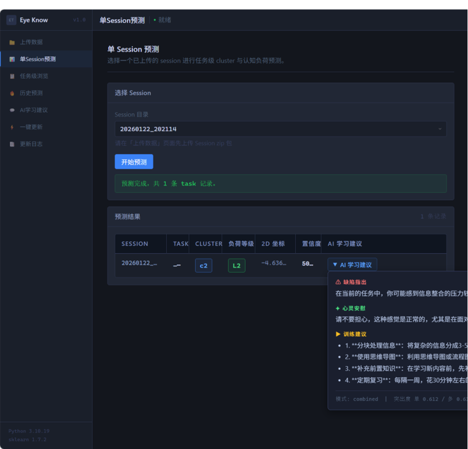

<p align="center">
  
</p>

# EyeKnow

<p align="center">
  <strong>用普通摄像头，把算法学习中的认知黑箱变成可解释的证据</strong>
</p>

<p align="center">
  
  
  
</p>

---

## 这是什么

EyeKnow 是一个面向**算法学习者和任课教师**的认知负荷评估平台。它不需要昂贵的专业眼动仪，只用电脑自带的普通摄像头，就能在不打断解题的前提下，捕捉你的注意力分配模式，告诉你：

> 你刚才在题目描述和样例之间反复回看了 2 分 14 秒，当前负荷偏高——可能需要换个策略。

教师端则把班级层面的共性卡点可视化，让"后排那位一直沉默的同学"不再被埋没。

---

## 产品长什么样

### 整体框架


### 学生端界面 —— 低干扰 HUD + 任务复盘

任务中默认只有一个小胶囊显示状态，不遮挡代码区。只有高负荷持续一段时间才会提示，而且提示可忽略、可暂停、可标记"不准确"。


### 数据分析网站 —— 任务复盘 + 证据归因

做题时客户端在本地采集 session 数据（原始摄像头帧永远不上传）。做完后一键上传，网站自动生成负荷曲线图、AOI 注意力分配、主要卡点时间段，并给出下一步建议。



---

## 核心亮点

| 能力 | 实现方式 |
|---|---|
| 低门槛采集 | 普通 RGB 摄像头（L2CS-Net），9 点校准，One Euro Filter 平滑 |
| 不打断设计 | 默认折叠 HUD，提示有节流，可一键切"仅记录"模式 |
| 187 维特征体系 | 注视、眼跳、AOI 转移、眨眼、区域覆盖……全部 schema 化、可版本化 |
| 双层模型 | KMeans 无监督聚类 → 负荷语义映射 → SVM 4 级分类；输出置信度和原因码 |
| 质量门控 | 校准失败、帧率过低、遮挡严重时不强行输出"确定结论" |
| 洛谷插件 | DOM 语义锚点 + 滚动/缩放校正，替代传统纵向比例切分 |
| 隐私默认 | 原始摄像头帧不落盘、不上传；云端只存派生特征和报告；可随时撤回 |

---

## 快速开始（V1.0 教学试点版）

```bash
# 1. 克隆仓库
git clone https://github.com/CoWora/cognitive-load-tracker.git

# 2. 安装 Chrome/Edge 浏览器插件（洛谷页面连接与 AOI 上报）
# 参考插件目录下的 README，开启开发者模式加载

# 3. 运行 Python 学生端采集程序
cd cognitive-load-tracker/client
python main.py
```

首次启动会引导你完成：知情同意 → 设备检查 → 9 点校准 → 进入洛谷做题。详细流程见 [PRD_Product_Design.md](./PRD_Product_Design.md)。

---

## 我的角色与贡献

本仓库为**产品侧作品集**，核心算法与工程代码由技术团队维护。作为产品负责人，我的主要工作：

- **架构与 PRD**：主导设计"采集 → 特征 → 模型 → 应用"四层架构，独立撰写完整 PRD（含状态机、质量门控、异常降级、数据 schema、试点研究设计等）
- **用户研究**：通过课堂观察和教师访谈，从"结果评价"反推"过程可见性"的核心痛点，确立非侵入、低干扰的产品定位
- **从原型到可试点**：补齐"判断可靠性、隐私合规、教师工作流、验收标准"四项产品化关键缺口，推动从 10 秒轮询原型到 2–3 秒端到端刷新的体验升级
- **项目统筹**：协调算法与工程团队推进，主导赛事路演。项目获评**北京市级大学生创新创业训练计划**立项、中国大学生计算机设计大赛**二等奖**

---

## 文档导览

| 文档 | 内容 |
|---|---|
| [PRD_Product_Design.md](./PRD_Product_Design.md) | 核心产品设计：四层架构、功能清单、详细设计、试点方案、验收标准、开放问题 |
| [EyeKnow_Project_Proposal_Full.pdf](./EyeKnow_Project_Proposal_Full.pdf) | 项目计划书：市场背景、技术路线、团队与落地情况 |
| [EyeKnow_Business_Plan_Full.pdf](./EyeKnow_Business_Plan_Full.pdf) | 商业计划书：竞品分析、SWOT、财务测算与风险控制 |
| [User_Research.md](./User_Research.md) | 用户调研记录：访谈提纲、用户画像提炼、痛点排序 |
| [Business_Plan.md](./Business_Plan.md) | 商业逻辑精简版 |

---

## 致谢

EyeKnow 项目团队的算法和工程同学，以及指导教师和试点课程的师生们。

---

> ⚠️ **重要声明**：V1.0 明确不做情绪识别、人格判断、疾病诊断；不把负荷等级用于成绩、排名、奖惩；不承诺仅凭眼动判断"会不会做"。产品定位是**认知过程的镜子**，不是注意力监控器。